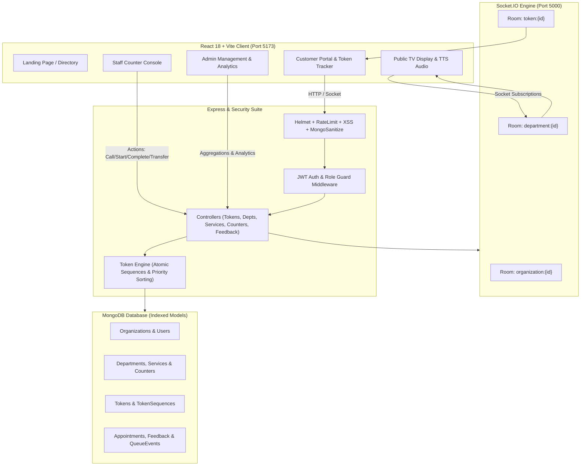

# 🚀 SmartQueue — Universal Token & Facility Flow Management Platform

A production-grade, multi-tenant MERN web application designed to eliminate physical waiting lines and streamline customer journeys across **Hospitals, Clinics, Banks, Government Offices, Telecom Centers, Salons, and Retail Stores**.

---

## 🌟 Key Capabilities

1. **Multi-Tenant Hierarchy & Strict Isolation**:
   - Complete data isolation per `Organization` → `Department` → `Service` → `Counter` → `Staff`.
   - Role-Based Access Control (`SUPER_ADMIN`, `ORGANIZATION_ADMIN`, `STAFF`, `CUSTOMER`).
   - Server-side organization derivation preventing cross-tenant data leakage.

2. **Concurrency-Safe Atomic Token Sequencing**:
   - Atomic sequence counter via MongoDB `$inc` and `findOneAndUpdate` keyed by `{ organizationId, serviceId, dateStr }`.
   - Automatic daily sequence resets with customizable prefixing (`GP001`, `LAB002`, `RX003`, `CASH001`).

3. **Intelligent Priority Queue Engine & Anti-Starvation**:
   - Dynamic priority tiers: `EMERGENCY (100)`, `VIP / SENIOR_CITIZEN / PREGNANT / DISABLED (60-80)`, `APPOINTMENT (40)`, `NORMAL (10)`.
   - **Automated Anti-Starvation Algorithm**: Normal tokens waiting > 30 minutes receive an automated `+50` effective weight boost to ensure fair throughput.

4. **Multi-Step Service Chaining & Transfers**:
   - Chained multi-department workflows (e.g., *Hospital OPD Consultation → Diagnostic Lab → Pharmacy Dispensary*).
   - Instant token transfer between services preserving customer context and historical timestamps.

5. **Real-Time Live TV Display & Web Speech Synthesis**:
   - Full-screen dark TV interface (`/display/:organizationId/:departmentId`).
   - Browser `window.speechSynthesis` audio announcements (*"Token GP001, please proceed to OPD Consultation Room 1"*).
   - Real-time Socket.IO room subscriptions (`organization:{id}`, `department:{id}`, `token:{id}`).

6. **Customer Portal & Live Tracking**:
   - Self-service token generation and appointment booking.
   - Live queue position tracking with progress bar and estimated wait time countdown.

7. **Analytics Dashboard & Customer Feedback**:
   - Live aggregations for daily throughput, wait times, service durations, hourly load curves, and completion rates.
   - Interactive 5-star customer feedback collection and admin ratings distribution.

8. **Hardened Production Security**:
   - Helmet HTTP security headers, 3-tier rate limiting, NoSQL injection sanitization, XSS payload filtering, and 10KB body size caps.

---

## 🏗️ Architecture & Flow



---

## 🛠️ Technology Stack

| Layer | Technology |
|---|---|
| **Frontend** | React 18, Vite, React Router v6, Axios, Tailwind CSS, Lucide React, Recharts, Socket.IO Client |
| **Backend** | Node.js (ES Modules), Express.js, Socket.IO 4.7, jsonwebtoken, bcryptjs, Helmet, Express Rate Limit, Express Mongo Sanitize, XSS |
| **Database** | MongoDB 6+ with Mongoose 8 (10 compound-indexed collections) |
| **Testing** | Jest 29, Supertest 7, cross-env (ESM test runner) |

---

## 📂 Project Structure

```
smartqueue/
├── client/                     # Vite + React Frontend
│   ├── src/
│   │   ├── components/         # ProtectedRoute, Modals, Shared UI
│   │   ├── context/            # AuthContext (JWT session management)
│   │   ├── layouts/            # AdminLayout (Sidebar), StaffLayout (Top nav)
│   │   ├── pages/
│   │   │   ├── admin/          # AdminDashboard, Departments, Services, Counters, Staff, Analytics, Feedback, Appointments
│   │   │   ├── customer/       # SelectService, TokenStatus, BookAppointment, CustomerDashboard, FeedbackPage
│   │   │   ├── public/         # OrganizationSelectorPage, PublicDisplayPage (Live TV)
│   │   │   ├── LandingPage.jsx
│   │   │   ├── LoginPage.jsx
│   │   │   └── RegisterPage.jsx
│   │   ├── services/           # api.js (Axios with Bearer Interceptor)
│   │   ├── App.jsx             # Client Routing Table
│   │   └── main.jsx
│   ├── package.json
│   ├── tailwind.config.js
│   └── vite.config.js
│
├── server/                     # Node.js + Express Backend
│   ├── src/
│   │   ├── config/             # db.js (Mongoose connection)
│   │   ├── controllers/        # auth, org, department, service, counter, staff, token, appointment, analytics, feedback
│   │   ├── middleware/         # authMiddleware, security, validate
│   │   ├── models/             # User, Organization, Department, Service, Counter, Token, TokenSequence, Appointment, Feedback, QueueEvent
│   │   ├── routes/             # Express route routers
│   │   ├── services/           # tokenEngine.js (Sequences, Wait Times, Priority Sorting, Anti-Starvation)
│   │   ├── sockets/            # socketManager.js (Room events & broadcast helpers)
│   │   ├── scripts/            # seed.js, testScripts
│   │   ├── app.js              # Express app configuration & middleware pipeline
│   │   └── server.js           # HTTP + Socket.IO server entry
│   ├── tests/                  # Jest & Supertest suites
│   │   ├── health.test.js
│   │   ├── security.test.js
│   │   ├── models.test.js
│   │   ├── tokenEngine.test.js
│   │   └── apiRoutes.test.js
│   ├── jest.config.js
│   └── package.json
└── README.md
```

---

## ⚡ Quick Start Guide

### 1. Prerequisites
- **Node.js**: v18.0+
- **MongoDB**: v6.0+ running locally on `mongodb://localhost:27017/smartqueue` (or MongoDB Atlas URI)

---

### 2. Backend Setup
```bash
cd server
npm install

# Configure environment variables
# (Pre-configured in server/.env)
# PORT=5000
# MONGO_URI=mongodb://localhost:27017/smartqueue
# JWT_SECRET=smartqueue_super_secret_jwt_key_2026_change_in_prod
# CLIENT_URL=http://localhost:5173

# Populate demo organizations, staff, tokens & feedback
npm run seed

# Run automated tests
npm test

# Start backend server
npm run dev
```

---

### 3. Frontend Setup
```bash
cd ../client
npm install

# Start Vite development server
npm run dev
```
Open **`http://localhost:5173`** in your browser.

---

## 👥 Demo Accounts & Credentials

All demo accounts use password: **`password123`**

| Role | Organization | Email | Purpose |
|---|---|---|---|
| **SUPER_ADMIN** | Global Platform | `superadmin@smartqueue.com` | Cross-tenant administration & oversight |
| **ORGANIZATION_ADMIN** | CityCare Hospital | `admin@citycare.com` | Department, Service, Staff, Analytics console |
| **STAFF (Doctor)** | CityCare Hospital | `doctor.smith@citycare.com` | OPD Consultation Room 1 Console (Call/Transfer) |
| **STAFF (Nurse)** | CityCare Hospital | `nurse.sarah@citycare.com` | Diagnostic Lab Station Console |
| **ORGANIZATION_ADMIN** | Metro Bank | `admin@metrobank.com` | Bank Branch Administration & Analytics |
| **STAFF (Teller)** | Metro Bank | `teller.john@metrobank.com` | Teller Window 1 Counter Console |

---

## 📺 Live TV Display URLs

Open in full screen on any TV monitor or browser tab:
- **CityCare Hospital (OPD Display)**: `http://localhost:5173/display/<CITYCARE_ORG_ID>/<OPD_DEPT_ID>`
- **Metro Bank (Retail Display)**: `http://localhost:5173/display/<METRO_ORG_ID>/<RETAIL_DEPT_ID>`

---

## 🧪 Running Automated Tests

Run the complete Jest & Supertest test suite:
```bash
cd server
npm test
```
**Results:** `5 test suites passed, 33 tests passed, 0 failures.`

---

## 🛡️ API Endpoints Reference

### Authentication (`/api/auth`)
- `POST /api/auth/register` — Register new user / org admin (Validated)
- `POST /api/auth/login` — Sign in and receive JWT (Rate limited)
- `GET /api/auth/me` — Current user profile (Protected)
- `PUT /api/auth/profile` — Update user details (Protected)

### Facility Management
- `/api/organizations` — CRUD organizations (Multi-tenant scoped)
- `/api/departments` — CRUD departments with cascade checks
- `/api/services` — CRUD services with estimated time & prefix
- `/api/counters` — CRUD counters with assigned staff sync
- `/api/staff` — CRUD staff members and assignments

### Token Lifecycle & Operations (`/api/tokens`)
- `POST /api/tokens` — Generate customer token (Concurrency safe)
- `GET /api/tokens/:id` — Live token position & wait time
- `GET /api/queue` — Sorted active queue list
- `POST /api/tokens/:id/call` — Call next token to counter (Staff)
- `POST /api/tokens/:id/recall` — Repeat token announcement (Staff)
- `POST /api/tokens/:id/start` — Start service timer (Staff)
- `POST /api/tokens/:id/complete` — Complete service and free counter (Staff)
- `POST /api/tokens/:id/skip` — Mark customer as skipped (Staff)
- `POST /api/tokens/:id/transfer` — Transfer customer to another department (Staff)

### Appointments, Analytics & Feedback
- `POST /api/appointments` — Book advance appointment
- `POST /api/appointments/:id/check-in` — Check in and receive priority token
- `GET /api/analytics` — Real-time metrics, hourly load, completion rate
- `POST /api/feedback` — Submit 1-5 star review (Public)
- `GET /api/feedback` — View feedback list & average rating (Admin)

---

## 📄 License
This project is licensed under the MIT License — see the LICENSE file for details. Built with ❤️ for seamless facility queue management.
